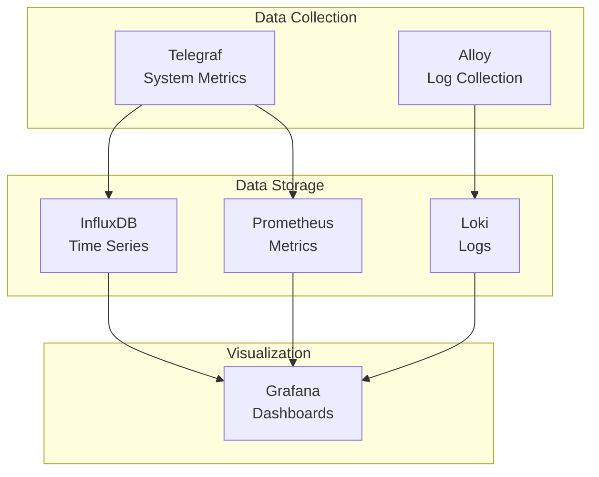

```
   ____  _ __  __            _ __           
  / __ \(_) /_/ /_____  ____(_) /_____  ____
 / /_/ / / __/ __/ __ \/ ___/ / __/ __ \/ ___/
/ ____/ / /_/ /_/ /_/ / /  / / /_/ /_/ / /    
/_/   /_/\__/\__/\____/_/  /_/\__/\____/_/     
```

# 🚀 PiMonitor - Advanced Docker Observability Stack

[](https://www.docker.com/)
[](https://www.arm.com/)
[](https://www.raspberrypi.org/)
[](LICENSE)

> **A comprehensive, enterprise-grade monitoring solution for Raspberry Pi and Linux systems using Docker. This stack provides complete observability with metrics collection, log aggregation, and visualization following modern Docker and Grafana best practices.**

## 📑 Table of Contents

- [✨ What's New in v2.0](#-whats-new-in-v20)
- [🏗️ Architecture Overview](#️-architecture-overview)
- [📋 Prerequisites](#-prerequisites)
- [🚀 Quick Start](#-quick-start)
- [⚙️ Configuration](#️-configuration)
- [🛠️ Service Management](#️-service-management)
- [📊 Monitoring Features](#-monitoring-features)
- [🔧 Troubleshooting](#-troubleshooting)
- [📚 Documentation](#-documentation)
- [🏛️ Architecture](#️-architecture)

---

## ✨ What's New in v2.0

### Major Enhancements
- **🏗️ Modular Architecture**: Separate Docker Compose files for development, production, and optional services
- **🔧 Advanced Configuration Management**: Template-based configuration with environment-specific validation
- **📊 Enhanced Log Monitoring**: Comprehensive Loki setup with Alloy for multi-source log collection
- **🛡️ Security Hardening**: Non-root users, resource limits, secrets management, and production validation
- **📜 Professional Scripts**: Modern shell scripting with structured logging, error handling, and validation
- **🔍 Comprehensive Validation**: Multi-level configuration validation with automated fixing
- **📈 Performance Optimization**: Optimized configurations for Raspberry Pi with proper resource management

## 🏗️ Architecture Overview

PiMonitor implements a layered architecture with proper service dependencies and security:



### Core Monitoring Stack
- **InfluxDB 2.7**: Time-series database with optimized performance settings and 90-day retention
- **Prometheus 2.48**: Metrics collection with comprehensive alerting rules and federation support
- **Loki 2.9**: Advanced log aggregation with dual schema support (v11/v12), WAL, and performance tuning
- **Alloy 0.38**: Unified telemetry collection with system logs, Docker containers, and application monitoring
- **Telegraf 1.28**: Comprehensive system metrics with Docker monitoring and security tracking
- **Grafana 10.2**: Advanced visualization with security hardening and pre-configured dashboards

### Key Features
- **🛡️ Security-First**: All services run as non-root users with comprehensive security validation
- **📊 Advanced Logging**: Multi-source log collection with structured parsing and correlation
- **🔍 Health Monitoring**: Comprehensive health checks with automatic recovery and alerting
- **🏗️ Modular Deployment**: Environment-specific configurations (development, production, staging)
- **⚡ Performance Optimized**: Resource limits, caching, and ARM64-specific optimizations
- **🔧 Configuration Management**: Template-based configuration with validation and templating
- **📈 Comprehensive Monitoring**: System metrics, container metrics, log analysis, and alerting
- **🚀 Production Ready**: Proper dependency ordering, startup coordination, and error handling

---

## 📋 Prerequisites

### 🍓 Raspberry Pi Compatibility
PiMonitor is optimized for Raspberry Pi and ARM64 systems:

**Supported Models:**
- ✅ **Raspberry Pi 4** (2GB/4GB/8GB) - Recommended
- ✅ **Raspberry Pi 5** - Excellent performance
- ⚠️ **Raspberry Pi 3** - Limited compatibility (consider upgrade)

**System Requirements:**
- **ARM64 (aarch64) architecture** - Full compatibility
- **Raspberry Pi OS 64-bit** or **Ubuntu 64-bit** - Recommended
- **Docker Engine 20.10+** with Docker Compose v2
- **Minimum 2GB RAM** (4GB+ recommended)
- **10GB+ free disk space** (SSD recommended for better performance)

### 🔍 Compatibility Check
Run the compatibility check before installation:
```bash
# Clone the repository first
git clone https://github.com/MatteoVincenti/PiMonitor.git
cd PiMonitor

# Check Raspberry Pi compatibility
./scripts/pi-compatibility-check.sh
```

### Required Docker Plugin
The Loki Docker driver must be installed before starting services:

```bash
# For ARM64 systems (Raspberry Pi 4/5 with 64-bit OS)
docker plugin install grafana/loki-docker-driver:3.3.2-arm64 --alias loki --grant-all-permissions

# For x86_64 systems
docker plugin install grafana/loki-docker-driver:latest --alias loki --grant-all-permissions
```

Verify installation:
```bash
docker plugin ls | grep loki
```

---

## 🚀 Quick Start

### 🎯 One-Command Setup
```bash
curl -fsSL https://raw.githubusercontent.com/MatteoVincenti/PiMonitor/main/scripts/install.sh | bash
```

### 🎮 New Unified Interface
After installation, use the new interactive interface:
```bash
./pimonitor    # Beautiful menu-driven interface with ASCII art
```

### 📋 Manual Installation

#### Option 1: Automated Setup (Recommended)
```bash
# Clone the repository
git clone https://github.com/MatteoVincenti/PiMonitor.git
cd PiMonitor

# Run interactive setup (handles everything automatically)
./scripts/setup.sh
```

The setup script will:
- ✅ Validate system requirements and Docker installation
- ✅ Install required Docker plugins (Loki driver)
- ✅ Generate secure credentials and environment configuration
- ✅ Create necessary directories and set proper permissions
- ✅ Deploy and validate the monitoring stack
- ✅ Provide access URLs and credentials

#### Option 2: Manual Setup
```bash
# 1. Clone and navigate
git clone https://github.com/MatteoVincenti/PiMonitor.git
cd PiMonitor

# 2. Install Loki Docker Plugin
docker plugin install grafana/loki-docker-driver:3.3.2-arm64 --alias loki --grant-all-permissions

# 3. Configure Environment
cp .env.example .env
./scripts/generate-secrets.sh  # Generate secure tokens
nano .env  # Review and customize settings

# 4. Validate Configuration
./scripts/validate-config.sh production

# 5. Deploy Stack
./scripts/deploy.sh start
```

### 🎯 Access Your Monitoring Stack

After deployment, access your services:

| Service | URL | Credentials |
|---------|-----|-------------|
| 🎨 **Grafana** | http://localhost:3000 | admin / *generated-password* |
| 📊 **Prometheus** | http://localhost:9090 | - |
| 💾 **InfluxDB** | http://localhost:8086 | - |
| 📝 **Loki** | http://localhost:3100 | - |
| 🔧 **Alloy** | http://localhost:12345 | - |

---

## ⚙️ Configuration

### 🔧 Environment Variables

| Variable | Default | Description |
|----------|---------|-------------|
| `GRAFANA_PORT` | 3000 | Grafana web interface port |
| `GRAFANA_ADMIN_PASSWORD` | - | Grafana admin password (required) |
| `INFLUXDB_PORT` | 8086 | InfluxDB API port |
| `PROMETHEUS_PORT` | 9090 | Prometheus web interface port |
| `LOKI_PORT` | 3100 | Loki API port |
| `ALLOY_PORT` | 12345 | Alloy web interface port |
| `COMPOSE_PROJECT_NAME` | pimonitor | Docker Compose project name |

### 📊 Resource Limits

Services are configured with appropriate resource limits for Raspberry Pi:

- **Grafana**: 512MB RAM, 0.5 CPU
- **InfluxDB**: 1GB RAM, 0.5 CPU  
- **Prometheus**: 512MB RAM, 0.5 CPU
- **Loki**: 512MB RAM, 0.5 CPU
- **Alloy**: 256MB RAM, 0.25 CPU
- **Telegraf**: 256MB RAM, 0.25 CPU

---

## 🛠️ Service Management

### 🎮 Core Stack Operations

**New Unified Interface (Recommended):**
```bash
# Interactive management interface with ASCII art branding
./pimonitor

# Quick access to specific operations
./maintenance.sh              # System maintenance and cleanup
./utilities.sh                # Backup, logs, configuration tools
```

**Direct Docker Commands (Still Supported):**
```bash
# Start all services
docker compose up -d

# Stop all services
docker compose down

# Restart specific service
docker compose restart grafana

# View service logs
docker compose logs -f grafana

# Check service status
docker compose ps
```

### 🚀 Enhanced Management Scripts

PiMonitor v2.0 introduces a **revolutionary unified interface** with professional ASCII art branding:

```bash
# 🎯 Main Management Interface (NEW!)
./pimonitor                    # Interactive menu for all operations

# 🔧 Consolidated Scripts  
./maintenance.sh               # System maintenance and cleanup
./utilities.sh                 # Backup, logs, config, and utilities
```

**✨ New Features:**
- **Professional ASCII Art Branding**: Consistent visual identity across all interfaces
- **Menu-Driven Interface**: Guided operations with intuitive navigation
- **Smart Terminal Detection**: Automatic fallback for narrow terminals and non-interactive sessions
- **Colored Status Indicators**: Visual feedback with ✓ ✗ ⚠ ℹ ⟳ symbols
- **Progress Animations**: Real-time feedback for long-running operations
- **Consolidated Functionality**: 15+ scripts consolidated into 3 main interfaces
- **Backward Compatibility**: All existing scripts remain functional for automation

**📖 Usage Guide:** See [USAGE_GUIDE.md](USAGE_GUIDE.md) for comprehensive usage instructions.

#### 📜 Legacy Script Support
PiMonitor provides production-ready management scripts with comprehensive error handling:

```bash
# Interactive setup with validation
./scripts/setup.sh

# Deployment management with environment selection
./scripts/deploy.sh

# Advanced configuration management
./scripts/config-manager.sh

# Comprehensive backup operations
./scripts/backup.sh

# Log management utilities
./scripts/logs.sh

# Docker resource cleanup with safety checks
./scripts/docker-cleanup.sh

# System maintenance with integrated Docker cleanup
./scripts/system-maintenance.sh

# Service lifecycle management
./scripts/start.sh
./scripts/stop.sh
```

All scripts include:
- **Structured logging** with timestamps and log levels
- **Error handling** with automatic cleanup and recovery
- **Input validation** and configuration verification
- **Progress tracking** and status reporting

### 🔧 Configuration Management

PiMonitor includes an advanced configuration management system:

```bash
# Validate configuration for specific environment
./scripts/config-manager.sh validate production

# Generate configuration files from templates
./scripts/config-manager.sh generate development

# Compare configurations between environments
./scripts/config-manager.sh diff development production

# Check configuration health and consistency
./scripts/config-manager.sh check

# Create configuration templates for services
./scripts/config-manager.sh template grafana

# Export configuration as portable package
./scripts/config-manager.sh export production -o prod-config.tar.gz
```

**Key Features:**
- **Environment-specific validation** with production security checks
- **Template-based configuration** generation with variable substitution
- **Configuration comparison** and health checking
- **Portable configuration** export/import for deployment automation
- **Service-specific templates** for Grafana, Prometheus, Loki, Alloy, Telegraf, and InfluxDB

### 🐳 Docker Resource Management

PiMonitor includes comprehensive Docker cleanup capabilities to maintain system health:

```bash
# Safe cleanup (containers and dangling images only)
./scripts/docker-cleanup.sh --safe

# Normal cleanup (containers, images, networks, dangling volumes)
./scripts/docker-cleanup.sh

# Aggressive cleanup (all unused resources including build cache)
./scripts/docker-cleanup.sh --aggressive

# Dry run to preview what would be cleaned
./scripts/docker-cleanup.sh --dry-run

# Generate cleanup report
./scripts/docker-cleanup.sh --report

# Force cleanup without confirmation (for automation)
./scripts/docker-cleanup.sh --force
```

**Cleanup Features:**
- **Safety checks** to protect running PiMonitor services
- **Multiple cleanup modes** from safe to aggressive
- **Dry run capability** to preview cleanup actions
- **Detailed reporting** with before/after statistics
- **Resource monitoring** with disk usage analysis
- **Automated confirmation** prompts with override options

### 🔧 System Maintenance

Comprehensive system maintenance with integrated Docker cleanup:

```bash
# Full system maintenance (updates + cleanup)
./scripts/system-maintenance.sh

# System updates only
./scripts/system-maintenance.sh --update-only

# System cleanup only (includes Docker cleanup)
./scripts/system-maintenance.sh --clean-only

# Automated maintenance with reboot if needed
./scripts/system-maintenance.sh --force --reboot

# Preview maintenance actions
./scripts/system-maintenance.sh --dry-run
```

**Maintenance Features:**
- **System updates** with package upgrades and security patches
- **Integrated Docker cleanup** using the enhanced cleanup script
- **Log rotation** and temporary file cleanup
- **Automatic reboot handling** for kernel updates
- **Comprehensive reporting** with system health metrics
- **Raspberry Pi optimized** for ARM64 systems

### 🔗 Service Dependencies

Services start in the following order to ensure proper dependencies:

1. **InfluxDB** → **Prometheus** → **Loki** (Data stores)
2. **Telegraf** (depends on InfluxDB, Prometheus)
3. **Alloy** (depends on Loki)
4. **Grafana** (depends on all data sources)

### 💚 Health Monitoring

All services include health checks that can be monitored:

```bash
# Check health status
docker compose ps

# View detailed health information
docker inspect pimonitor_grafana | grep -A 10 Health
```

---

## 📊 Monitoring Features

### 📈 System Metrics (Telegraf → InfluxDB/Prometheus)
- CPU usage, load average, and temperature
- Memory and swap utilization
- Disk I/O and filesystem usage
- Network interface statistics
- Docker container metrics

### 📝 Log Aggregation (Alloy → Loki)
- System logs (syslog, auth.log, kern.log)
- Docker container logs with automatic labeling
- Application logs with service identification
- Structured logging with metadata
- **Enhanced Performance**: WAL support, dual schema (v11/v12), embedded caching
- **Optimized for Pi**: 32MB/s ingestion rate, 768MB total cache allocation

### 🎨 Visualization (Grafana)
- **Enterprise-grade configuration** with comprehensive security hardening
- **Pre-configured dashboards** for system overview and log analysis
- **Advanced alerting** with unified alerting system and legacy compatibility
- **Multi-datasource support** (InfluxDB, Prometheus, Loki) with optimized queries
- **Security features**: Brute force protection, XSS protection, content type validation
- **Performance optimization**: Gzip compression, log rotation, resource limits
- **Professional logging**: Structured logging with rotation and retention policies

---

## 🔧 Troubleshooting

### ⚠️ Common Issues

**Loki Driver Not Found**
```bash
# Install the Loki Docker plugin
docker plugin install grafana/loki-docker-driver:3.3.2-arm64 --alias loki --grant-all-permissions
```

**Migrating from Previous Versions**
```bash
# Run Homarr cleanup verification (if upgrading from versions with Homarr)
./scripts/cleanup-homarr.sh

# Follow the migration guide for detailed instructions
# See docs/MIGRATION.md
```

**Service Won't Start**
```bash
# Check service logs
docker compose logs service-name

# Verify configuration
docker compose config

# Check resource usage
docker stats
```

**Port Conflicts**
```bash
# Check what's using a port
sudo netstat -tulpn | grep :3000

# Modify ports in .env file
echo "GRAFANA_PORT=3001" >> .env
docker compose up -d
```

---

## 📚 Documentation

- **[Usage Guide](USAGE_GUIDE.md)** - Comprehensive guide to the new v2.0 interface
- **[Migration Notes](MIGRATION_NOTES.md)** - Script consolidation and migration information
- [Deployment Guide](docs/deployment.md) - Detailed deployment instructions
- [Configuration Reference](docs/configuration.md) - Complete configuration options
- [Configuration Management](docs/configuration-management.md) - Advanced configuration management system
- [Troubleshooting Guide](docs/troubleshooting.md) - Common issues and solutions
- [Migration Guide](docs/MIGRATION.md) - Upgrading from previous versions

---

## 🏛️ Architecture

The stack uses a custom bridge network (`skynet`) for service isolation and implements proper security practices:

- All services run as non-root users
- Resource limits prevent system overload
- Health checks ensure service reliability
- Centralized logging via Loki driver
- Persistent data storage with named volumes

---

## 🤝 Contributing

We welcome contributions! Please see our [Contributing Guide](CONTRIBUTING.md) for details.

## 📄 License

This project is licensed under the MIT License - see the [LICENSE](LICENSE) file for details.

## 🙏 Acknowledgments

- [Grafana Labs](https://grafana.com/) for the amazing observability stack
- [Docker](https://www.docker.com/) for containerization technology
- [Raspberry Pi Foundation](https://www.raspberrypi.org/) for the incredible hardware
- The open-source community for continuous inspiration

---

<div align="center">

**Made with ❤️ for the Raspberry Pi community**

[](https://github.com/MatteoVincenti/PiMonitor/stargazers)
[](https://github.com/MatteoVincenti/PiMonitor/network/members)

</div>